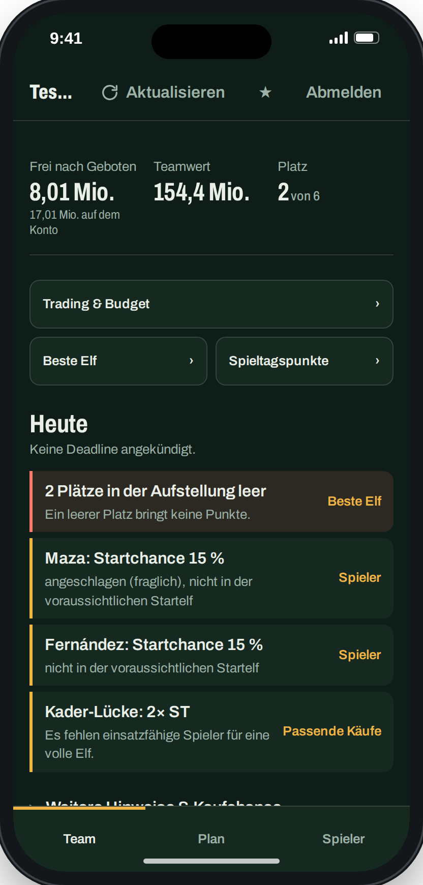
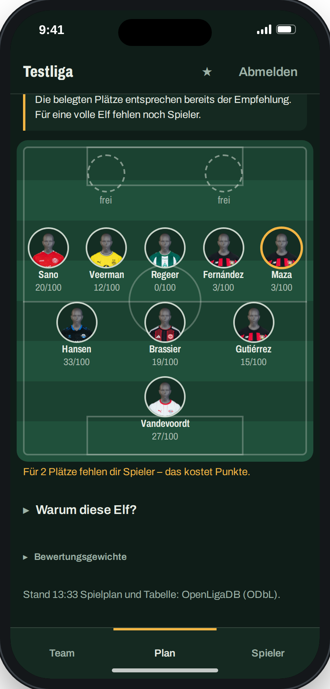
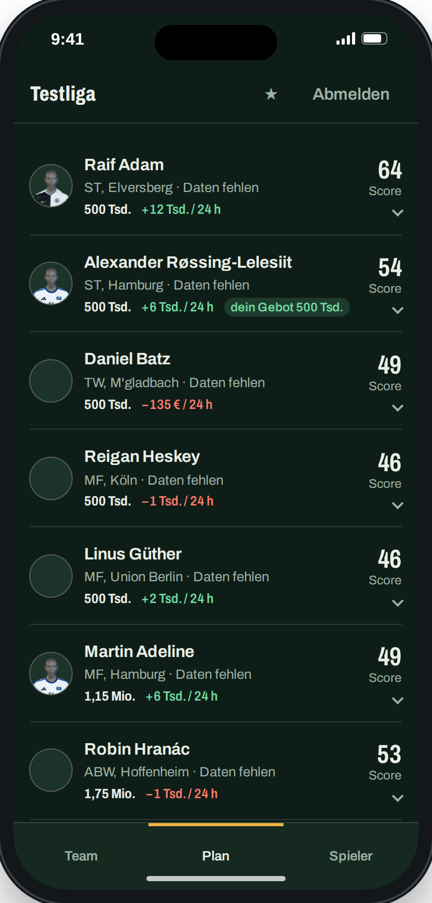
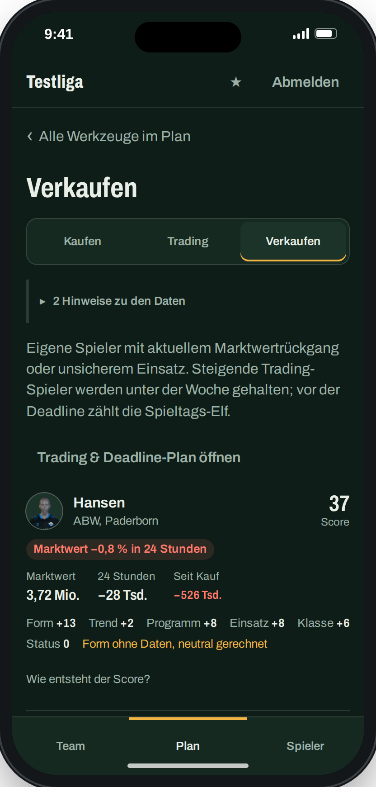
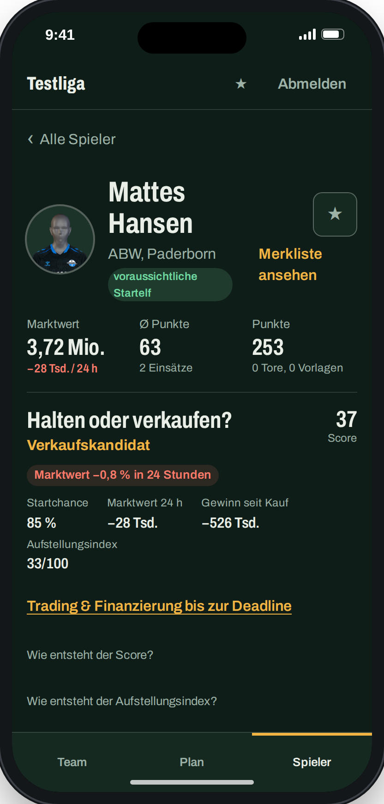
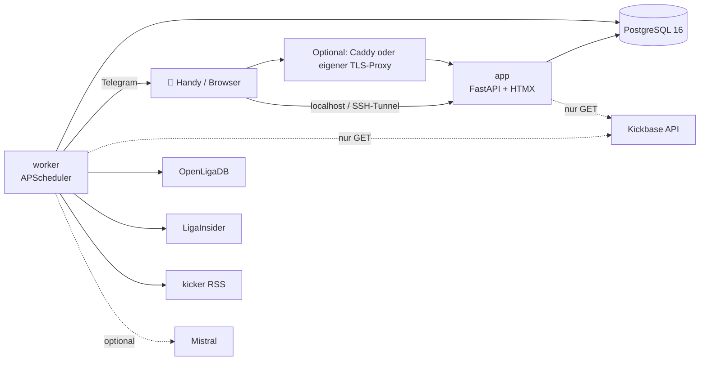

<p align="center">
  
</p>

<p align="center">
  <a href="https://github.com/WolkeWeb/kickbase-helper/actions/workflows/ci.yml"></a>
  
  
  
  
  
</p>

<p align="center">
  Privates, mobil-first Dashboard für einen Kickbase-Account – mit Empfehlungen, die zeigen,
  <b>warum</b> sie etwas empfehlen.
</p>

<p align="center">
  
  
  
  
  
</p>

<p align="center"><sub>
  Heute · Beste Elf · Kaufen · Verkaufen · Spieler – Demo mit erfundenen Daten („Testliga“),
  keine echten Konto-, Liga- oder Managerdaten.
</sub></p>

> [!IMPORTANT]
> **Inoffizielles Community-Projekt** ohne Verbindung zu Kickbase, LigaInsider oder kicker.
> Es nutzt eine nicht dokumentierte Kickbase-API. Automatisierter Zugriff kann gegen die
> Nutzungsbedingungen von Kickbase verstoßen und im Extremfall zur Sperrung des Accounts
> führen. Nutzung auf eigenes Risiko und ohne Gewähr (siehe [Lizenz](LICENSE)).

## Auf einen Blick

**Was es ist:** Ein Dashboard für **deinen** Kickbase-Account und **eine** Liga. Es zeigt dir
Aufstellung, Kader, Budget und Marktwerte und sagt dir, wen du kaufen, halten oder verkaufen
solltest – jede Empfehlung mit nachvollziehbaren Gründen statt Blackbox.

**Was du brauchst:**

- Docker mit Compose (auf dem eigenen Rechner, Homelab oder Server) und ein Kickbase-Account.
- Optional: Telegram-Bot für Meldungen, Mistral-Gratis-Key für KI-Texte, eigene Domain für HTTPS.
  Ohne diese Extras läuft alles weiter.

**Was es nicht ist:**

- Kein gehosteter Dienst: Du betreibst es selbst, die Daten bleiben bei dir.
- Kein Mehrbenutzer-System und kein Liga-Umschalter.
- Kein Bot: Es gibt **keine** Gebote, Verkäufe oder Aufstellungsänderungen. Der Kickbase-Client
  erlaubt technisch nur `GET` und den Login.

## Inhalt

[Funktionen](#funktionen) ·
[Schnellstart](#schnellstart) ·
[Wie die Empfehlungen entstehen](#wie-die-empfehlungen-entstehen) ·
[Betrieb und Konfiguration](#betrieb-und-konfiguration) ·
[Architektur](#architektur) ·
[Datenquellen und Spielregeln](#datenquellen-und-spielregeln) ·
[Entwicklung und Beiträge](#entwicklung-und-beiträge)

## Funktionen

- **Heute** – Countdown bis zur Aufstellungs-Deadline und alles, was davor zu tun ist.
- **Mein Team** – Budget, Teamwert, Ligaplatz, Aufstellung, Kader und Spieltags-Bilanz.
- **Kaufen / Verkaufen / Trading** – Marktangebote und eigene Spieler mit Score, Gebotsempfehlung
  und Verkaufs-Guide.
- **Beste Elf und Transfer-Simulation** – stärkste Aufstellung und „Was wäre, wenn“ für Käufe
  und Verkäufe, rein lokal gerechnet.
- **Spielerseiten** – Form, Startchance, Gegnerprogramm, Marktwert- und Punkteverlauf.
- **Bilanz** – wie sich frühere Empfehlungen und eigene Gebote entwickelt haben.
- **Telegram (optional)** – Meldungen, Deadline-Warnung, Morgen-Briefing, Fragen an das
  Dashboard und eine Merkliste mit Alarmen.

Alle Seiten im Detail: [docs/features.md](docs/features.md).

## Schnellstart

Benötigt werden **Docker mit Compose und ein Kickbase-Account**. Der erste Start funktioniert
lokal ohne Domain, IONOS oder VPN. In Bash unter Linux/macOS:

```bash
git clone https://github.com/WolkeWeb/kickbase-helper.git && cd kickbase-helper
docker build -f docker/app.Dockerfile -t kickbase-helper-app:latest .
docker run --rm -it --network none --user "$(id -u):$(id -g)" \
  -v "$PWD:/setup" -w /setup \
  kickbase-helper-app:latest python /srv/setup.py
docker compose up -d
```

Der Assistent fragt die eigene Liga, Kickbase-Zugangsdaten und ein separates Dashboard-Passwort
ab. Er speichert Secrets lokal, erzeugt die nötigen Schlüssel und überschreibt keine bestehende
Einrichtung. Danach **http://localhost:8080** öffnen. Alternativ mit Python 3.12 und `uv`:
`uv run python scripts/setup.py`, anschließend `docker compose up -d --build`.

Details, Zugriffsvarianten und die Übernahme vorhandener Installationen:
**[docs/self-hosting.md](docs/self-hosting.md)**.

## Wie die Empfehlungen entstehen

Jeder Score (0–100) zeigt seine Bestandteile mit Gewicht und Begründung – nichts ist eine Blackbox.

| Bestandteil | Was er misst |
|---|---|
| **Form** | Punkte der letzten 5 Spieltage (neuere zählen mehr), als Rang in der Position |
| **Trend** | Marktwert-Änderung der letzten 7 Tage |
| **Programm** | Stärke der nächsten 3 Gegner, Heim/Auswärts |
| **Einsatz** | Startchance: LigaInsider-Prognose, Verletzungen, Startquote der letzten Vereinsspiele |
| **Klasse** | Marktwert-Rang in der Position plus Saison-Ø – damit ein Top-Spieler nach einer schwachen Woche nicht unter Mittelmaß fällt |
| **Status** | Abzug für angeschlagen, Aufbautraining, verletzt/gesperrt |

Kaufen, Verkaufen und Beste Elf gewichten die Bestandteile unterschiedlich. Alle Gewichte
stehen in [`config/scoring.yaml`](config/scoring.yaml) und werden auf den Seiten angezeigt.

Der **Aufstellungsindex** (0–100 je Spieler) ergänzt den Score: Startchance × positionsbezogener
Formrang × Programm der nächsten Gegner. Er ist eine relative Kennzahl – tatsächliche
Kickbase-Punkte oder Wahrscheinlichkeiten werden damit nicht vorhergesagt. Fehlende Daten werden
im Ergebnis kenntlich gemacht.

## Betrieb und Konfiguration

Für Server, Handy und PWA den passenden Zugriff in `.env` wählen:

| Variante | Compose-Ergänzung | Voraussetzung |
|---|---|---|
| Lokal / SSH-Tunnel | `compose.local.yaml` (Standard) | keine Domain |
| HTTPS mit Caddy | `compose.https.yaml` | beliebiger DNS-Anbieter, eigene Domain und erreichbare ACME-Ports |
| Eigener TLS-Proxy | `compose.external.yaml` | vorhandener Reverse Proxy; App nur auf Loopback |
| IONOS DNS-01 | `compose.ionos.yaml` | optionales IONOS-Token; auch für rein interne Hosts |

Telegram und KI bleiben optional. Die **experimentelle** Claude-Bridge (`compose.claude.yaml`)
nutzt die Claude Code CLI des Hosts – ob das mit dem eigenen Claude-Tarif vereinbar ist, bitte
selbst prüfen.

| Datei | Wofür |
|---|---|
| `.env` | Zugriffsvariante, Secret-Pfade, Liga, Zeitzone, Login und optionale Integrationen |
| [`config/scoring.yaml`](config/scoring.yaml) | Score-Gewichte, Gebotsempfehlung, Verkaufs-Guide, Trading-Schwellen, Deadline-Puffer |
| [`config/ai.yaml`](config/ai.yaml) | harte KI-Grenzen: Aufrufe, Tokens, Budget pro Tag/Monat |
| [`config/notifications.yaml`](config/notifications.yaml) | Schwellen für Telegram-Meldungen |
| [`config/ligainsider.yaml`](config/ligainsider.yaml), [`config/team_mapping.yaml`](config/team_mapping.yaml) | Zuordnung der Datenquellen zu Kickbase-Vereinen |

## Architektur


- **app** rendert die Seiten (Jinja2 + HTMX, Chart.js) mit eigenem Login.
- **worker** sammelt nach festem Zeitplan Marktwerte, Punkte, Aufstellungen, Prognosen,
  Verletzungen, Meldungen und Liga-Transfers und schickt Telegram-Nachrichten
  (Zeitplan: [`docs/plan.md`](docs/plan.md)).
- **Zugriff wählbar:** lokal auf Loopback, Caddy mit Standard-HTTPS, eigener Reverse Proxy oder
  optional IONOS DNS-01. VPN und DNS-Anbieter sind Teil der eigenen Infrastruktur.

## Datenquellen und Spielregeln

| Quelle | Wofür | Hinweise |
|---|---|---|
| Kickbase (inoffizielle API) | Kader, Markt, Budget, Marktwerte, Punkte | nur lesend, höchstens 2 parallele Requests, Cache |
| [OpenLigaDB](https://www.openligadb.de) | Spielplan, Tabelle | Lizenz ODbL |
| [LigaInsider](https://www.ligainsider.de) | voraussichtliche Aufstellungen, Verletzte | schonendes Scraping, ≤ 1 Abruf alle 2 s, feste Zeitfenster |
| [kicker](https://www.kicker.de) | Meldungen (RSS: Titel, Teaser, Link) | dreimal täglich |
| Mistral (optional) | Meldungen auswerten, Briefing, Chat, Spieler-Einschätzung | Gratis-Plan; nur Bundesliga-Daten und der eigene Kader, nie Namen anderer Manager |

Abgerufene Daten bleiben in der eigenen Installation; keine privaten Liga-Daten oder kompletten
Drittanbieter-Webseiten in öffentliche Issues, PRs oder Screenshots übernehmen. Fällt eine
Quelle aus oder ändert sich eine Seite, zeigt die App das sichtbar an, statt alte Daten
als aktuell auszugeben.

Wer das Projekt betreibt, ist selbst für die Nutzungsbedingungen dieser Dienste verantwortlich;
die eingebauten Grenzen (Abstände, Zeitfenster, Caches) bitte nicht lockern.

## Entwicklung und Beiträge

```bash
uv sync                                   # Abhängigkeiten
uv run ruff check . && uv run ruff format --check .
uv run pytest -n auto                     # Tests mit gespeicherten Fixtures, nie gegen Live-APIs
```

Beiträge sind willkommen: [CONTRIBUTING.md](CONTRIBUTING.md) und
[Verhaltenskodex](CODE_OF_CONDUCT.md). Projektstruktur, Tests, Screenshots und Arbeitsweise:
[docs/development.md](docs/development.md).

## Sicherheit und Lizenz

Sicherheitsmeldungen: [SECURITY.md](SECURITY.md). Herkunft und Lizenztexte der eingebundenen
Bibliotheken und API-Spezifikation: [THIRD_PARTY_NOTICES.md](THIRD_PARTY_NOTICES.md).
Der eigene Projektcode steht unter der [MIT-Lizenz](LICENSE). Der Veröffentlichungscheck samt
Grenzen der historischen Bereinigung steht in [docs/publication.md](docs/publication.md).
