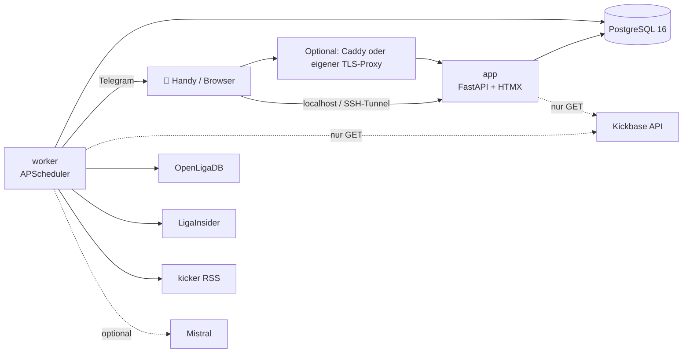

<p align="center">
  
</p>

<p align="center">
  <a href="https://github.com/WolkeWeb/kickbase-helper/actions/workflows/ci.yml"></a>
  
  
  
  
  
</p>

<p align="center">
  Privates, mobil-first Dashboard für einen Kickbase-Account – mit Empfehlungen, die zeigen,
  <b>warum</b> sie etwas empfehlen.<br>
  Single-User, läuft als Docker-Stack im Homelab und greift <b>nur lesend</b> auf Kickbase zu.
</p>

> [!IMPORTANT]
> **Inoffizielles Community-Projekt** ohne Verbindung zu Kickbase, LigaInsider oder kicker.
> Es nutzt eine nicht dokumentierte Kickbase-API. Automatisierter Zugriff kann gegen die
> Nutzungsbedingungen von Kickbase verstoßen und im Extremfall zur Sperrung des Accounts
> führen. Nutzung auf eigenes Risiko und ohne Gewähr (siehe [Lizenz](LICENSE)).

---

## Inhalt

- [Was es kann](#was-es-kann)
- [Wie die Empfehlungen entstehen](#wie-die-empfehlungen-entstehen)
- [Architektur](#architektur)
- [Schnellstart](#schnellstart)
- [Konfiguration](#konfiguration)
- [Entwicklung](#entwicklung)
- [Datenquellen und Spielregeln](#datenquellen-und-spielregeln)

## Was es kann

| | |
|---|---|
| **Heute** | Countdown bis zur Aufstellungs-Deadline und alles, was davor zu tun ist: leere Plätze, Startspieler mit Ausfallrisiko, Minus, Kaderlücken, offene Gebote, beste Kaufchance – jeweils mit Link. |
| **Mein Team** | Budget, Teamwert, Ligaplatz, Aufstellung auf dem Spielfeld, Kader mit aktueller 24-h-Marktwertbewegung, Originalartikeln auch ohne KI und datierten Ausfall-/Rückkehrmeldungen, **Spieltags-Bilanz** (Punkte, Platz mit Δ, Top/Flop, verpasste Punkte durch die Bank) mit Rangverlauf-Diagramm. |
| **Eigener Stammkader** | Spieler lokal schützen oder als Trading notieren. Finanzierungspläne verkaufen geschützte Stammspieler nicht; ein dadurch ungedecktes Defizit bleibt sichtbar. Eigene hypothetische Verkäufe sind im Simulator mit Warnung möglich. |
| **Transfer-Simulation** | Verkäufe und Käufe lokal kombinieren: Wunschpreis, Budget nach verbleibenden Geboten, beste Formation/Index und freie Plätze. Unbestätigte oder zu späte Käufe zählen nicht zur nächsten Elf. Einstieg über Trading oder ein Kaufangebot. |
| **Spieltagspunkte** | Eigene gespeicherte Spieltags-Elf mit vorläufigen Spielerpunkten und offizieller Spieltagssumme. Datenstand sichtbar, Bank getrennt, während möglicher laufender Partien bei sichtbarer Online-Seite im 10-Minuten-Takt. |
| **Kaufen** | Marktangebote als kompakte Zeilen mit Score, Preis, Gebotsempfehlung (70-%-Quantil der Liga-Käufe), **Aufstellungsindex und Index pro Mio. €** und Deadline-Hinweis; Filter nach Position, Preis, Kaderlücke. |
| **Verkaufen** | Spieler mit aktuellem Marktwertrückgang oder vor der Deadline schlechter Startchance; steigende Trading-Spieler werden unter der Woche gehalten; im Minus der Verkaufs-Guide mit der Kombination, die **am wenigsten Punkte kostet**. |
| **Trading** | Tagesanstieg und Gewinn seit Kauf; eigener Plan bis zur echten Deadline mit Budget nach offenen Geboten, nötigen Verkäufen und Schutz der vorgeschlagenen Elf. Kaufchancen berücksichtigen Aufschlag und verbleibende Updates; Gewinne werden nur als Szenario gezeigt. |
| **Beste Elf** | Die stärkste Aufstellung aus dem Kader nach **Aufstellungsindex** (0–100 je Spieler), mit Notbesetzung statt leerer Plätze. |
| **Spieler** | „Kaufen?“ bzw. „Halten oder verkaufen?“ mit Score und Gründen, **Aufstellungsindex** für die nächsten Spiele mit Aufschlüsselung Startchance × Form × Gegner, Startchance (LigaInsider-Prognose, Verletzungen, Startquote), Markt-Karte, Marktwert- und Punkte-Verlauf, KI-Einschätzung. |
| **Bilanz** | Wie sich empfohlene Spieler nach 1, 3 und 7 Tagen entwickelt haben und wie die eigenen Gebote ausgingen. |
| **Telegram** | Meldungen zu eigenen Spielern, Warnung ~2 h vor der Deadline, Morgen-Briefing – und Fragen an das Dashboard („Wen soll ich verkaufen?“), beantwortet nur aus den eigenen Daten. **Spieltags-Bilanz** nach Abpfiff (Punkte, Platz-Änderung, Top/Flop, verpasste Punkte); dieselbe Bilanz steht im Lagebild des Bots und auf der Team-Seite. **Merkliste** (`/merkliste`): Alarme, wenn ein beobachteter Spieler auf den Markt kommt, sein Preis eine Schwelle (`price_below`) unterschreitet, sich sein Status ändert oder er aus der LigaInsider-Prognose-Elf fällt; dieselben Spieler stehen im Lagebild des Bots. **Gebote auf eigene Spieler**: Alarm, sobald ein anderer Liga-Manager einen meiner gelisteten Spieler über Marktwert überbietet; dieselben Listings stehen ebenfalls im Lagebild des Bots (ohne Bietername). |

Auf dem Handy gebaut (375 px, Dark Mode, PWA fürs Homescreen-Icon), ab 900 px zweispaltig.
Live-Screenshots mit privaten Liga- und Kontodaten gehören nicht ins Repository.

## Wie die Empfehlungen entstehen

Jeder Score (0–100) zeigt seine Bestandteile mit Gewicht und Begründung – nichts ist eine Blackbox.

Der **Aufstellungsindex** ergänzt den Score: Startchance × positionsbezogener Formrang ×
Programm der nächsten Gegner, auf einer Skala von 0–100. Er ist eine relative Kennzahl;
tatsächliche Kickbase-Punkte und Wahrscheinlichkeiten werden damit nicht vorhergesagt.
Fehlende Daten werden im Ergebnis kenntlich gemacht. Die Beste Elf maximiert die Index-Summe.

| Bestandteil | Was er misst |
|---|---|
| **Form** | Punkte der letzten 5 Spieltage (neuere zählen mehr), als Rang in der Position |
| **Trend** | Marktwert-Änderung der letzten 7 Tage |
| **Programm** | Stärke der nächsten 3 Gegner, Heim/Auswärts |
| **Einsatz** | Startchance: LigaInsider-Prognose, Verletzungen, Startquote der letzten Vereinsspiele |
| **Klasse** | Marktwert-Rang in der Position plus Saison-Ø – damit ein Top-Spieler nach einer schwachen Woche nicht unter Mittelmaß fällt |
| **Status** | Abzug für angeschlagen, Aufbautraining, verletzt/gesperrt |

Kaufen, Verkaufen und Beste Elf gewichten die Bestandteile unterschiedlich. Alle Gewichte stehen
in [`config/scoring.yaml`](config/scoring.yaml) und werden auf den Seiten angezeigt.

## Architektur



- **app** rendert die Seiten (Jinja2 + HTMX, Chart.js), mit eigenem Login.
- **worker** sammelt nach festem Zeitplan Marktwerte, Punkte, Aufstellungen, Prognosen, Verletzungen,
  Meldungen und Liga-Transfers und schickt Telegram-Nachrichten. Zeitplan: [`docs/plan.md`](docs/plan.md).
- **Zugriff wählbar:** lokal auf Loopback, Caddy mit Standard-HTTPS, eigener Reverse Proxy oder
  optional IONOS DNS-01. VPN und DNS-Anbieter sind Teil der eigenen Infrastruktur.
- Der Kickbase-Client erlaubt ausschließlich `GET` und den Login – jede andere Methode wirft eine Exception.

## Schnellstart

Benötigt werden **Docker mit Compose und ein Kickbase-Account**. Der erste Start funktioniert
lokal ohne Domain, IONOS oder VPN. In Bash unter Linux/macOS:

```bash
git clone https://github.com/WolkeWeb/kickbase-helper.git && cd kickbase-helper
docker build -f docker/app.Dockerfile -t kickbase-helper-app:latest .
docker run --rm -it --network none --user "$(id -u):$(id -g)" \
  -v "$PWD:/setup" -w /setup \
  kickbase-helper-app:latest python /srv/setup.py
docker compose up -d
```

Der Assistent fragt die eigene Liga, Kickbase-Zugangsdaten und ein separates Dashboard-Passwort
ab. Er speichert Secrets lokal, erzeugt die nötigen Schlüssel und überschreibt keine bestehende
Einrichtung. Danach **http://localhost:8080** öffnen. Alternativ mit Python 3.12 und `uv`:
`uv run python scripts/setup.py`, anschließend `docker compose up -d --build`.

Für Server/Handy/PWA den passenden Zugriff in `.env` wählen:

| Variante | Compose-Ergänzung | Voraussetzung |
|---|---|---|
| Lokal / SSH-Tunnel | `compose.local.yaml` (Standard) | keine Domain |
| HTTPS mit Caddy | `compose.https.yaml` | beliebiger DNS-Anbieter, eigene Domain und erreichbare ACME-Ports |
| Eigener TLS-Proxy | `compose.external.yaml` | vorhandener Reverse Proxy; App nur auf Loopback |
| IONOS DNS-01 | `compose.ionos.yaml` | optionales IONOS-Token; auch für rein interne Hosts |

**[Einrichtung, Varianten und Übernahme vorhandener Installationen](docs/self-hosting.md)**.
Telegram und KI bleiben optional; ohne ihre Keys läuft das Dashboard weiter. Die
**experimentelle** Claude-Bridge (`compose.claude.yaml`) nutzt die Claude Code CLI des Hosts –
ob das mit dem eigenen Claude-Tarif vereinbar ist, bitte selbst prüfen.

## Konfiguration

| Datei | Wofür |
|---|---|
| `.env` | Zugriffsvariante, Secret-Pfade, Liga, Zeitzone, Login und optionale Integrationen |
| [`config/scoring.yaml`](config/scoring.yaml) | Score-Gewichte, Gebotsempfehlung, Verkaufs-Guide, Trading-Schwellen und Deadline-Puffer |
| [`config/ai.yaml`](config/ai.yaml) | harte KI-Grenzen: Aufrufe, Tokens, Budget pro Tag/Monat |
| [`config/notifications.yaml`](config/notifications.yaml) | Schwellen für Telegram-Meldungen |
| [`config/ligainsider.yaml`](config/ligainsider.yaml) | Zuordnung LigaInsider-Seiten → Vereine |
| [`config/team_mapping.yaml`](config/team_mapping.yaml) | Zuordnung OpenLigaDB → Kickbase-Vereine |

## Entwicklung

```bash
uv sync                                   # Abhängigkeiten
uv run ruff check . && uv run ruff format --check .
uv run pytest -n auto                     # Tests (parallel) mit gespeicherten Fixtures, nie gegen Live-APIs
uv run alembic upgrade head               # Migrationen
```

- Tests laufen gegen anonymisierte Fixtures unter `tests/fixtures/` (Kickbase, LigaInsider);
  Postgres-Tests zusätzlich mit `TEST_POSTGRES_URL`.
- Mobile Screenshots und Prüfung auf horizontales Scrollen: `scripts/screenshot.py --base URL`;
  Ausgabe lokal unter `artifacts/screenshots/` (gitignored).
- Arbeitsweise, Regeln und Übergaben zwischen Agenten: [`AGENTS.md`](AGENTS.md),
  aktueller Stand in [`HANDOFF.md`](HANDOFF.md), Ausbauplan in [`docs/roadmap.md`](docs/roadmap.md).
  Was davon nur zum Ablauf des Maintainers gehört: [`docs/maintainer/`](docs/maintainer/README.md).

```
app/
  kickbase/     Client (nur lesend), Cache, Modelle      lineups/   LigaInsider, Startelf-Prognosen
  services/     Scores, Empfehlungen, Guide, Briefing    bot/       Telegram-Fragen (Lagebild, Werkzeuge)
  worker/       Sammeljobs und Zeitplan                  llm/       Mistral mit harten Limits
  web/          Routen, Templates, CSS, PWA              news/      kicker-Meldungen
config/  docs/  scripts/  tests/  alembic/  docker/
```

## Datenquellen und Spielregeln

| Quelle | Wofür | Hinweise |
|---|---|---|
| Kickbase (inoffizielle API) | Kader, Markt, Budget, Marktwerte, Punkte | nur lesend, höchstens 2 parallele Requests, Cache |
| [OpenLigaDB](https://www.openligadb.de) | Spielplan, Tabelle | Lizenz ODbL |
| [LigaInsider](https://www.ligainsider.de) | voraussichtliche Aufstellungen, Verletzte | schonendes Scraping, ≤ 1 Abruf alle 2 s, feste Zeitfenster |
| [kicker](https://www.kicker.de) | Meldungen (RSS: Titel, Teaser, Link) | dreimal täglich |
| Mistral (optional) | Meldungen auswerten, Briefing, Chat, Spieler-Einschätzung | Gratis-Plan; nur Bundesliga-Daten und der eigene Kader, nie Namen anderer Manager |

Abgerufene Daten bleiben in der eigenen Installation; keine privaten Liga-Daten oder kompletten
Drittanbieter-Webseiten in öffentliche Issues, PRs oder Screenshots übernehmen. Fällt eine
Quelle aus oder ändert sich eine Seite, zeigt die App das sichtbar an, statt alte Daten
als aktuell auszugeben.

Wer das Projekt selbst betreibt, ruft diese Dienste mit der eigenen Installation ab und ist
selbst dafür verantwortlich, deren Nutzungsbedingungen einzuhalten. Die eingebauten Grenzen
(Abstände, Zeitfenster, Caches) bitte nicht lockern.

## Sicherheit und Drittanbieter

Sicherheitsmeldungen: [SECURITY.md](SECURITY.md). Herkunft und Lizenztexte der eingebundenen
Bibliotheken und API-Spezifikation: [THIRD_PARTY_NOTICES.md](THIRD_PARTY_NOTICES.md).
Der eigene Projektcode steht unter der [MIT-Lizenz](LICENSE). Beiträge: [CONTRIBUTING.md](CONTRIBUTING.md)
und [Verhaltenskodex](CODE_OF_CONDUCT.md).
Der Veröffentlichungscheck samt Grenzen der historischen Bereinigung steht in
[docs/publication.md](docs/publication.md).
